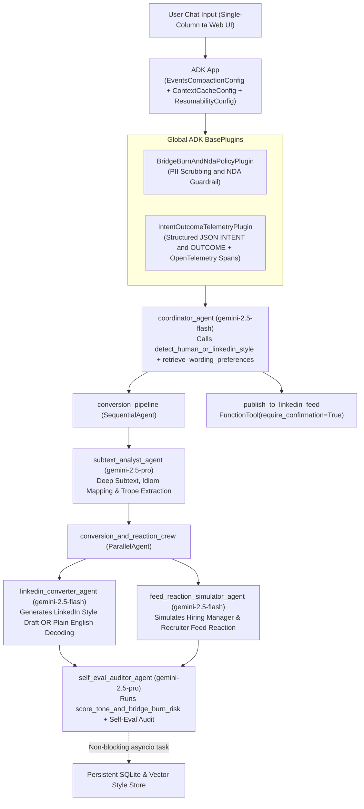

# Thrilled to Announce (`ta`)

**Thrilled to Announce** (`ta`) is an Apache-2.0 conversational AI application built with **Google Agent Development Kit (ADK)** and **Vertex AI Gemini (`gemini-2.5-pro` & `gemini-2.5-flash`)** that automatically detects and translates between candid everyday language (`HUMAN_DAILY`) and polished LinkedIn announcements (`LINKEDIN_SPEAK`), learns and persists personal wording preferences across sessions (`STYLE_TWEAK`), enforces NDA / anti-doxxing / PII guardrails, and requires code-enforced Human-in-the-Loop confirmation (`PUBLISH_REQUEST`) before publishing.

---

## Minimal 7-State Conversational UI (`frontend/`)

The web interface uses the `#0a66c2` **`ta`** (*Thrilled to Announce*) rounded-square badge and circular message avatar on a warm `#f4f2ee` single-column canvas—with zero LinkedIn `in` icons, zero sidebars, and zero telemetry clutter:

| State | UI Label / Surface | Conversational Behavior |
| :---: | :--- | :--- |
| **1. Welcome** | Concise launch card + 2 starter chips | Introduces bidirectional `Human ⇄ LinkedIn` translation via `GET /api/welcome` with one-click starter prompts and `"New chat"` reset. |
| **2. Human -> LinkedIn** | `LinkedIn Style` | Converts blunt everyday thoughts into diplomatic, career-safe LinkedIn drafts with `Copy · Post to LinkedIn` actions. |
| **3. Tweak & Save Memory** | `LinkedIn Style` + `✓ Style preference saved` | Applies natural-language wording tweaks immediately and persists rules asynchronously via `asyncio.create_task`. |
| **4. Next Conversion** | `LinkedIn Style` + `Using your saved style` | Automatically recalls saved formatting (`paragraph`, `bullets`, `broetry`), conciseness, banned words, and emoji rules across new sessions. |
| **5. LinkedIn -> Human** | `Plain English` | Decodes corporate euphemisms, humblebrags, and job-post red flags into candid 1-sentence plain English (`Copy` action only). |
| **6. Post Approval** | `Post to LinkedIn?` (`Cancel` / `Post` modal) | Halts `publish_to_linkedin_feed` via `FunctionTool(..., require_confirmation=True)` (`status="awaiting_human_confirmation"`) until human confirmation. |
| **7. Safety Guardrail** | `Confidentiality Check` | Short-circuits unreleased financial numbers, internal project codenames, and doxxing via `BridgeBurnAndNdaPolicyPlugin`. |

---

## Multi-Agent ADK Architecture



---

## Repository Layout

```text
thrilled-to-announce/
├── .agents-cli-spec.md                      # Phase 0-7 google-agents-cli & adk lifecycle specification
├── .dockerignore                            # Excludes local state, secrets, tests, and IaC from image context
├── .env.example                             # Sanitized environment variable template (YOUR_PROJECT_ID)
├── .gcloudignore                            # Excludes local state, secrets, tests, and IaC from Cloud Build uploads
├── .gitignore                               # Protects .env*, keys, uv.lock, .agents/, SQLite & Terraform state
├── .github
│   └── workflows
│       └── ci.yml                           # GitHub Actions CI: Ruff, AST gate, hygiene scan, pytest, 26 evals, Terraform
├── CONSTITUTION.md                          # 7-rule agent constitution loaded into system instructions
├── CONTRIBUTING.md                          # Google Open Source CLA & contribution guidelines
├── Dockerfile                               # Non-root Python 3.12 slim container (UID 10001, PORT=8080)
├── LICENSE                                  # Apache License 2.0
├── pyproject.toml                           # Hatchling build, ADK + GCP dependencies, pytest & Ruff settings
├── README.md                                # Architecture, CLI workflows & Cloud Run deployment guide
├── thrilled_to_announce/
│   ├── agent.py                             # Hierarchical ADK multi-agent graph (Coordinator -> Sequential -> Parallel -> Auditor)
│   ├── app.py                               # ADK App (EventsCompactionConfig, ContextCacheConfig, ResumabilityConfig, plugins)
│   ├── schemas/                             # Strict Pydantic v2 input and output contracts (extra="forbid")
│   ├── config/                              # AppSettings & SecretManagerResolver (Secret Manager + Vertex AI ADC)
│   ├── observability/                       # PiiScrubber (Cloud DLP + regex), structlog JSON logger, OTel Cloud Trace
│   ├── plugins/                             # BridgeBurnAndNdaPolicyPlugin & IntentOutcomeTelemetryPlugin
│   ├── memory/                              # Persistent DatabaseSessionService / SqliteSessionService + VectorStyleMemoryStore
│   ├── tools/                               # 5 validated ADK tools + HITL FunctionTool(require_confirmation=True)
│   ├── prompts/                             # Structured constitution & per-agent system instructions
│   └── routing/                             # StrategicModelRouter (gemini-2.5-flash vs gemini-2.5-pro)
├── server/
│   └── main.py                              # FastAPI server (/, /static/*, /health, /api/welcome, /api/chat, /api/publish/*, /api/telemetry)
├── frontend/                                # Vanilla HTML, CSS, and JS implementing all 7 conversational UI states
├── eval/                                    # 26-case golden_dataset.json, run_eval.py, ADK *.evalset.json & test_config.json
├── terraform/                               # Cloud Run v2, Vertex AI, DLP, Cloud Trace, Secret Manager & least-privilege IAM
└── tests/                                   # Unit, integration, infrastructure, hygiene & end-to-end pytest suites
```

---

## Local Quickstart & Environment Configuration

1. **Create a virtual environment and install dependencies**:
   ```bash
   python3 -m venv .venv
   .venv/bin/pip install --upgrade pip
   .venv/bin/pip install -e ".[dev]"
   ```

2. **Configure environment variables** (never commit `.env` or real credentials):
   ```bash
   cp .env.example .env
   ```
   Key settings in `.env.example`:
   - `GOOGLE_GENAI_USE_VERTEXAI=TRUE` — Uses Google Cloud IAM Application Default Credentials (`gcloud auth application-default login`).
   - `GOOGLE_CLOUD_PROJECT=YOUR_PROJECT_ID` — Target Google Cloud project identifier.
   - `GOOGLE_CLOUD_LOCATION=us-central1` — Vertex AI and Cloud Run region.
   - `GEMINI_API_KEY_SECRET_ID=gemini-api-key` — Secret Manager secret ID resolved via `SecretManagerResolver` when not using Vertex AI ADC.
   - `ENABLE_CLOUD_DLP=FALSE` — Set `TRUE` on Google Cloud to enable Sensitive Data Protection (`dlp_v2.DlpServiceClient`) alongside deterministic regex scrubbing.
   - `OTEL_EXPORT_TO_CLOUD=TRUE` — Exports OpenTelemetry spans via `CloudTraceSpanExporter` when a Google Cloud project is configured.
   - `THRILLED_DATA_DIR=.thrilled_data` — Persistent directory for SQLite sessions and vector style memory (`SESSION_SERVICE_URI` also supports `postgresql+asyncpg://...` and `sqlite+aiosqlite:///...`).
   - `THRILLED_FLASH_MODEL=gemini-2.5-flash` & `THRILLED_PRO_MODEL=gemini-2.5-pro` — Strategic model routing targets.

3. **Run the conversational web application locally**:
   ```bash
   .venv/bin/uvicorn server.main:app --host 0.0.0.0 --port 8080
   ```
   Open `http://localhost:8080` in your browser. Exposed endpoints:
   - `GET /` & `GET /static/*` — Single-column `ta` conversational UI
   - `GET /health` — Container startup and liveness probe (`{"status": "ok"}`)
   - `GET /api/welcome` — Concise launch greeting and 2 starter prompts
   - `POST /api/chat` — Automatic style detection, conversion, async preference persistence, and policy guardrails
   - `POST /api/publish/request` & `POST /api/publish/confirm` — Code-enforced HITL publishing state machine
   - `GET /api/telemetry` — PII-scrubbed structured JSON `INTENT` / `OUTCOME` logs and OpenTelemetry spans

---

## `agents-cli` & `adk` CLI Workflow

Full lifecycle details are documented in [`.agents-cli-spec.md`](.agents-cli-spec.md).

```bash
# Inspect, lint, evaluate, and deploy with google-agents-cli
uvx google-agents-cli setup
agents-cli info
agents-cli lint
agents-cli eval run --evalset eval/thrilled_to_announce.evalset.json --config eval/test_config.json
agents-cli deploy --dry-run --project YOUR_PROJECT_ID --region us-central1 --port 8080
agents-cli deploy \
  --project YOUR_PROJECT_ID \
  --region us-central1 \
  --service-account thrilled-agent-sa@YOUR_PROJECT_ID.iam.gserviceaccount.com \
  --port 8080

# Interactive ADK web UI with persistent SQLite sessions and Cloud Trace export
.venv/bin/adk web \
  --port 8000 \
  --session_service_uri sqlite:///./.thrilled_data/adk_sessions.sqlite3 \
  --trace_to_cloud \
  --otel_to_cloud \
  .

# Single-turn ADK CLI execution (note: `adk run` does not take --trace_to_cloud)
.venv/bin/adk run thrilled_to_announce "I am tired of my current company and just wanted to find something not that boring"

# ADK EvalSet trajectory and response evaluation
.venv/bin/adk eval thrilled_to_announce eval/thrilled_to_announce.evalset.json \
  --config_file_path=eval/test_config.json \
  --print_detailed_results

# Direct ADK Cloud Run deployment with Cloud Trace and Secret Manager injection
.venv/bin/adk deploy cloud_run \
  --project=YOUR_PROJECT_ID \
  --region=us-central1 \
  --service_name=thrilled-to-announce \
  --app_name=thrilled_to_announce \
  --port=8080 \
  --with_ui \
  --trace_to_cloud \
  --otel_to_cloud \
  thrilled_to_announce \
  -- --no-invoker-iam-check --set-secrets=GEMINI_API_KEY=gemini-api-key:latest
```

---

## Automated Testing & 26-Case Golden Evaluation Suite

Every push and pull request on `main` runs `.github` workflows (`ci.yml`), enforcing Ruff lint, AST zero-print verification, secret/hygiene scanning, `pytest`, the 26-case evaluation harness, and `terraform validate`:

```bash
# 1. Lint check
.venv/bin/ruff check .

# 2. Unit, integration, infrastructure, and hygiene test suite
.venv/bin/pytest

# 3. Deterministic CI evaluation across all 26 golden cases (Suites A-F in eval/golden_dataset.json)
.venv/bin/python -m eval.run_eval

# 4. Live Vertex AI Gemini + LLM-as-judge rubric evaluation (requires GCP auth)
.venv/bin/python -m eval.run_eval --live
```

The evaluation suite covers all **26** benchmark cases (`eval-A01`..`eval-A08` `Human -> LinkedIn`, `eval-B01`..`eval-B06` `LinkedIn -> Plain English`, `eval-C01`..`eval-C05` welcome + async cross-session style memory & override consolidation, `eval-D01`..`eval-D03` profanity stripping + NDA & anti-doxxing blocks, `eval-E01`..`eval-E02` `[REDACTED_*]` PII scrubbing + paired `INTENT` / `OUTCOME` OTel telemetry, and `eval-F01`..`eval-F02` guided `recoverable_error` recovery + `awaiting_human_confirmation` HITL stop), alongside ADK `AgentEvaluator` thresholds (`tool_trajectory_avg_score`, `response_match_score`) in `eval/test_config.json`.

---

## Google Cloud Run & Terraform Deployment (`YOUR_PROJECT_ID`)

### Option A — Governed Terraform Infrastructure as Code (`terraform/`)

`terraform/` provisions all 7 required Google Cloud APIs (`aiplatform`, `artifactregistry`, `cloudbuild`, `cloudtrace`, `dlp`, `run`, `secretmanager`), Artifact Registry (`thrilled-repo`), least-privilege runtime service account (`thrilled-agent-sa`), Secret Manager secret (`gemini-api-key` + initial Vertex-ADC sentinel version with `ignore_changes = [secret_data]`) + secret-scoped IAM, and Cloud Run v2 (`invoker_iam_disabled`, `/health` startup and liveness probes, scaling `0..5`, and Secret Manager `secret_key_ref`):

```bash
# 1. Initialize Terraform and bootstrap Artifact Registry (plus required APIs)
terraform -chdir=terraform init
terraform -chdir=terraform apply \
  -target=google_artifact_registry_repository.docker_repo \
  -var="project_id=YOUR_PROJECT_ID" \
  -var="region=us-central1"

# 2. Build and push the container image via Cloud Build
gcloud builds submit . \
  --tag=us-central1-docker.pkg.dev/YOUR_PROJECT_ID/thrilled-repo/thrilled-to-announce:latest \
  --project=YOUR_PROJECT_ID \
  --quiet

# 3. Apply the full Terraform stack
terraform -chdir=terraform apply \
  -var="project_id=YOUR_PROJECT_ID" \
  -var="region=us-central1" \
  -var="container_image=us-central1-docker.pkg.dev/YOUR_PROJECT_ID/thrilled-repo/thrilled-to-announce:latest"
```

### Option B — Direct `gcloud run deploy` CLI (`--set-secrets` & `--no-invoker-iam-check`)

Ensure the runtime service account (`thrilled-agent-sa`) and at least one version of the `gemini-api-key` secret exist in Secret Manager (`gcloud secrets create` / `gcloud secrets versions add`—resolved at startup by `SecretManagerResolver` in `thrilled_to_announce/config/secrets.py` when not using Vertex AI ADC), then create the Docker repository, build the image, and deploy:

```bash
gcloud artifacts repositories create thrilled-repo \
  --repository-format=docker \
  --location=us-central1 \
  --project=YOUR_PROJECT_ID \
  --quiet

gcloud builds submit . \
  --tag=us-central1-docker.pkg.dev/YOUR_PROJECT_ID/thrilled-repo/thrilled-to-announce:latest \
  --project=YOUR_PROJECT_ID \
  --quiet

gcloud run deploy thrilled-to-announce \
  --image=us-central1-docker.pkg.dev/YOUR_PROJECT_ID/thrilled-repo/thrilled-to-announce:latest \
  --region=us-central1 \
  --platform=managed \
  --port=8080 \
  --no-invoker-iam-check \
  --service-account=thrilled-agent-sa@YOUR_PROJECT_ID.iam.gserviceaccount.com \
  --set-secrets=GEMINI_API_KEY=gemini-api-key:latest \
  --set-env-vars=GOOGLE_GENAI_USE_VERTEXAI=TRUE,GOOGLE_CLOUD_PROJECT=YOUR_PROJECT_ID,GOOGLE_CLOUD_LOCATION=us-central1,OTEL_EXPORT_TO_CLOUD=TRUE,THRILLED_DATA_DIR=/tmp/thrilled_data,THRILLED_FLASH_MODEL=gemini-2.5-flash,THRILLED_PRO_MODEL=gemini-2.5-pro \
  --project=YOUR_PROJECT_ID \
  --quiet
```

---

## License & Contributing

Licensed under the [Apache License 2.0](LICENSE). Please review [CONTRIBUTING.md](CONTRIBUTING.md) prior to submitting pull requests.
